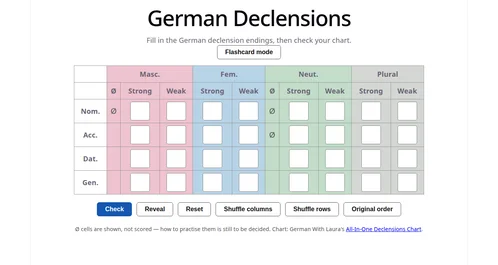
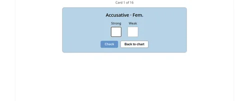

# German Declensions Quiz

A personal Vue 3 + TypeScript + Vite app for practising German declension
endings — fill in the whole chart, or drill one case at a time with
flashcards.

The chart follows German With Laura's
[All-In-One Declensions Chart](https://germanwithlaura.com/declension/):
rows are Nominative / Accusative / Dative / Genitive, columns are Masculine /
Feminine / Neuter / Plural, each split into Strong and Weak. The three
no-declension (Ø) cells — Masc. Nom., Neut. Nom., Neut. Acc. — are fillable
too: type Ø or 0, scored separately (3 points on top of the 32).

## Chart mode



Fill in all 32 Strong and Weak endings, then hit **Check** to see your score
and the correct ending for any wrong cell. The three Ø cells take Ø or 0 and
are scored separately, 3 points on top of the 32. **Reveal** fills in the
whole chart; **Reset** clears it.

- **Auto-tab:** typing a letter moves to the next input (Backspace on an
  empty cell goes back).
- **Shuffle:** **Shuffle columns** reorders the gender columns and **Shuffle
  rows** reorders the cases, so you can't memorise positions; **Original
  order** restores the chart. Shuffles animate — rows glide to their new
  spots, columns fade in place.
- **Mobile:** on narrow screens the table becomes one stacked card per case.

## Flashcard mode



**Flashcard mode** (or `/flashcards`) deals all 16 case/gender combos in a
shuffled deck, one card at a time. Each card asks for the Strong and Weak
endings; hit **Check** (or Enter) for immediate feedback — wrong endings turn
red with the correct letter shown. A card counts as correct only when both
endings are right. At the end of the deck you get a score out of 16, a
to-review list of the missed cards, and a **Reshuffle** button for a new deck.

Keyboard-friendly: after a correct card the focus moves to **Next**, so one
Enter press advances; a new card focuses its first input straight away.

## Develop

```sh
npm install
npm run dev
```

## Build

```sh
npm run build
```

## Deploy

Deployed on Vercel. `vercel.json` rewrites every path to `index.html`, so
deep links like `/flashcards` load on a direct visit or refresh instead of
404ing.
